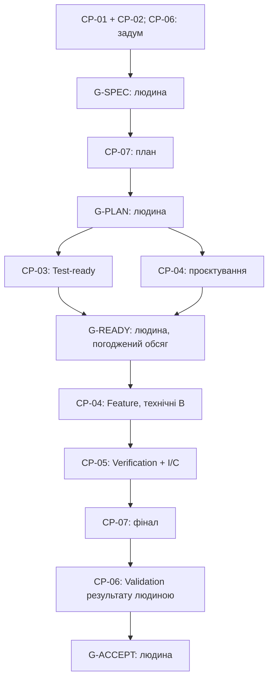

# Залежності компактних тікетів

Чинні джерела: [декомпозиція](revised-decomposition.md), [ролі](roles.md), [Issues](issue-mapping.md). B — блокування початку пункту, I — спільна інтеграційна перевірка, C — умова завершення. Залежності стосуються готовності матеріалів і пунктів чеклістів, не обов’язкового закриття всієї картки.

| Тікет | Блокувальні передумови / дозволений початок |
| --- | --- |
| [CP-01 #1](https://github.com/safonovdmitrij/car-rental-system/issues/1) | Аналіз джерел можна почати без GO; погодження уточнень для заявленого обсягу — людиною, разом із CP-02 і CP-06/задум до G-SPEC. |
| [CP-02 #2](https://github.com/safonovdmitrij/car-rental-system/issues/2) | Підготовка паралельно CP-01; залежні очікування — лише після рішення відповідного Q. Доповнення приймає людина до G-SPEC. |
| [CP-03 #7](https://github.com/safonovdmitrij/car-rental-system/issues/7) | Після G-PLAN і погоджених CP-01/CP-02 для відповідного обсягу. Test-ready означає підготовлені випадки, фікстури, очікування та спосіб запуску; успішне проходження продуктом планується після реалізації в CP-05. |
| [CP-04 #13](https://github.com/safonovdmitrij/car-rental-system/issues/13) | Реалізація лише після актуального людського GO G-READY для названого обсягу REQ, готовності відповідних тестів CP-03, погоджених уточнень і технічних B-пунктів. Окремого ручного GO для кожного F немає. Проєктування готується після G-PLAN до G-READY. |
| [CP-05 #29](https://github.com/safonovdmitrij/car-rental-system/issues/29) | Після реалізації потрібних F і Test-ready; запуск окремих готових перевірок не чекає всієї CP-04. Інтеграційні I/C потрібні до завершення звіту, а не для початку незалежної реалізації. |
| [CP-06 #35](https://github.com/safonovdmitrij/car-rental-system/issues/35) | Задум — до G-SPEC; результат — після прийнятих CP-05 і фінальної CP-07, до G-ACCEPT. Обидва висновки виконує виключно людина. |
| [CP-07 #37](https://github.com/safonovdmitrij/car-rental-system/issues/37) | Планові матеріали готуються з погодженої бази до G-PLAN; чернетки — разом із готовими F; фінал — після CP-05 до Validation результату. |
| [CP-08 #3](https://github.com/safonovdmitrij/car-rental-system/issues/3) | Запис матеріалів можна почати зараз; кожне з чотирьох рішень ухвалює тільки людина після його передумов у декомпозиції. |

Для кожного F діють G-SPEC → G-PLAN → Test-ready та підготовка проєктування → G-READY для погодженого обсягу. Немає персональних READY-GATE. Якщо G-READY погоджує всю першу версію, всі шість пакетів CP-03 мають бути готові до цього рішення. Якщо обсяг обмежений, виключені REQ залишаються заблокованими до перегляду G-READY.

Test-ready до реалізації — готовність тестів і очікувань, а не успішна робота ще не створеного продукту. Test-pass — фактичний результат після реалізації у CP-05. Невирішений Q блокує залежні очікування та код; підготовка незалежних матеріалів дозволена.

| Пункт CP-04 | Test-ready CP-03 | Додаткові B-пункти CP-04 | Q для уточнення |
| --- | --- | --- | --- |
| F003 | P002 | — | Q-02, Q-03 |
| F004 | P001 | — | Q-09 |
| F005 | P001 | F004 | —; застосовні уточнення за REQ |
| F006 | P001 | F004 | —; застосовні уточнення за REQ |
| F007 | P002 | — | Q-07 |
| F008 | P003 | F007 | Q-04, Q-07 |
| F009 | P001, P003 | F003, F004, F007, F008, F014 | —; застосовні уточнення за REQ |
| F010 | P004 | F009 | —; застосовні уточнення за REQ |
| F011 | P001, P004 | F007, F009, F010, F014 | —; застосовні уточнення за REQ |
| F012 | P005 | F014 | Q-02, Q-04, Q-05 |
| F013 | P001, P005 | F014 | Q-06 |
| F014 | P001, P003, P004, P005 | — | —; застосовні уточнення за REQ |
| F015 | P006 | — | —; застосовні уточнення за REQ |
| F016 | P006 | — | Q-08 |
| F017 | P006 | — | Q-10 |
| F018 | P006 | — | —; застосовні уточнення за REQ |

### Збережені інтеграційні зв’язки I

Ці партнери не створюють нових B початку F. Якщо партнер також є B у таблиці вище, його базовий результат лишається B, а спільний сценарій — I.

| Пункт CP-04 | Партнери I у CP-04 | Докази |
| --- | --- | --- |
| F003 | F007, F009, F010, F012, F013 | CP-05/V002 і застосовні V партнерів |
| F004 | F005, F014 | CP-05/V001 і застосовні V партнерів |
| F005 | F014 | CP-05/V001 і застосовні V партнерів |
| F006 | F009, F010, F014 | CP-05/V001 і застосовні V партнерів |
| F007 | F009 | CP-05/V002 і застосовні V партнерів |
| F008 | F009, F012 | CP-05/V003 і застосовні V партнерів |
| F009 | F010, F012, F013 | CP-05/V003 і застосовні V партнерів |
| F010 | F006, F011, F014 | CP-05/V004 і застосовні V партнерів |
| F011 | F003, F013 | CP-05/V004 і застосовні V партнерів |
| F012 | F003, F008, F009, F013 | CP-05/V005 і застосовні V партнерів |
| F013 | F003, F009, F010, F012 | CP-05/V005 і застосовні V партнерів |
| F014 | F003, F004, F005, F006, F007, F008, F009, F010, F011, F012, F013 | CP-05/V001 і застосовні V партнерів |
| F015 | F003, F004, F005, F006, F007, F008, F009, F010, F011, F012, F013, F014 | CP-05/V006 і застосовні V партнерів |
| F016 | F004, F005, F006, F007, F008, F009, F010, F011, F012, F013, F014 | CP-05/V006 і застосовні V партнерів |
| F017 | F003, F009, F010, F011, F018 | CP-05/V006 і застосовні V партнерів |
| F018 | F003, F004, F005, F006, F007, F008, F009, F010, F011, F012, F013, F014 | CP-05/V006 і застосовні V партнерів |

### Verification: B початку та C завершення

Потрібні додаткові пакети CP-03 з таблиці F також використовуються. V не чекають результатів інших V як передумови запуску; кожний перевіряє фактичну готову реалізацію та її партнерів.

| Пункт CP-05 | B: Test-ready і основні реалізації | I/C: реалізації до повного завершення |
| --- | --- | --- |
| V001 | P001; F004, F005, F006, F014 | F003, F007, F008, F009, F010, F011, F012, F013; усі спільні випадки перевірені |
| V002 | P002; F003, F007 | F009, F010, F012, F013; усі спільні випадки перевірені |
| V003 | P003; F008, F009 | F010, F012, F013; усі спільні випадки перевірені |
| V004 | P004; F010, F011 | F003, F006, F013, F014; усі спільні випадки перевірені |
| V005 | P005; F012, F013 | F003, F008, F009, F010; усі спільні випадки перевірені |
| V006 | P006; F015, F016, F017, F018 | F003, F004, F005, F006, F007, F008, F009, F010, F011, F012, F013, F014; усі спільні випадки перевірені |

CP-08 має ранні й фінальне рішення, CP-06 та CP-07 мають ранні й фінальні матеріали. Вимога закрити ці картки до Feature створила б хибний цикл; граф будується за пунктами.

Перевірка: граф основних переходів і технічних B пунктів F ациклічний. I не додано до блокувальних ребер реалізації. Незалежні F не чекають завершення всього етапу; Verification починається після відповідного коду і завершується після всіх потрібних інтеграційних партнерів.
